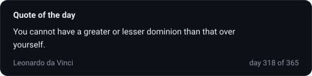

<h1 align="center">Luciano K. Dal Pai</h1>

  <b>Full-Stack Software Engineer</b>

  
  

<h3 align="center">Languages</h3>

  

<h3 align="center">Frameworks and tools</h3>

  
   
  

<h3 align="center">GitHub</h3>

  
  

  
    Cards are self-hosted and refreshed daily by <a href="./.github/workflows">GitHub Actions</a>
    &nbsp;·&nbsp;
    
  

