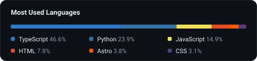

<h1 align="center">Luciano K. Dal Pai</h1>

  <b>Full-Stack Software Engineer</b> · Landing pages, business websites, custom web systems and automations

  
  

 

### Featured projects

<table>
  <tr>
    <td width="50%" valign="top">
      <b><a href="https://github.com/lucianookdp/scammeter">Scammeter</a></b> 
      Tells you whether a Brazilian site is a scam, and why: company ID, Pix key, domain age and phishing lists. Chrome extension and web page, no server.  
      <a href="https://chromewebstore.google.com/detail/scammeter/ggdfieojdidphlaboocccagclecnlhja">Chrome Web Store</a> · <a href="https://lucianookdp.github.io/scammeter/">Live</a>
    </td>
    <td width="50%" valign="top">
      <b><a href="https://github.com/lucianookdp/eleicoes-brasil">Eleições Brasil</a></b> 
      Real-time Brazilian election results from official TSE data only: map, both rounds, candidate pages and a big-screen mode.  
      <a href="https://eleicoes.lucianookdp.dev">Live</a> · Next.js · Fastify · PostgreSQL
    </td>
  </tr>
  <tr>
    <td width="50%" valign="top">
      <b><a href="https://github.com/lucianookdp/cnpj-due-diligence">CNPJ Due Diligence</a></b> 
      Company checks built on public data: ownership graph, restrictive lists, federal debt and an explainable 0-100 risk score.  
      <a href="https://lucianookdp.github.io/cnpj-due-diligence/">Live</a> · FastAPI · React · PostgreSQL
    </td>
    <td width="50%" valign="top">
      <b><a href="https://github.com/lucianookdp/EasyRGB">EasyRGB</a></b> 
      Free, open-source RGB controller for Windows: motherboard, RAM and keyboard, each with its own effect, game mode and schedules.  
      <a href="https://github.com/lucianookdp/EasyRGB/releases/latest">Download</a> · Python · OpenRGB
    </td>
  </tr>
</table>

 

### Stack

  
  
  
  
  
  
  

  
  
  
  
  
  
  
  
  
  

  
  
  
  
  

 

  

  

  

